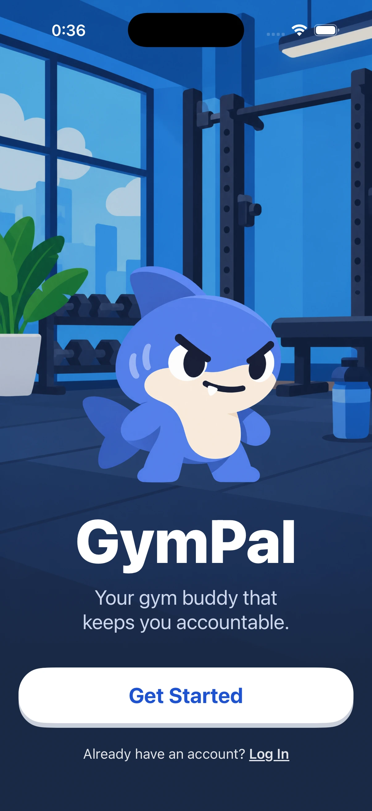
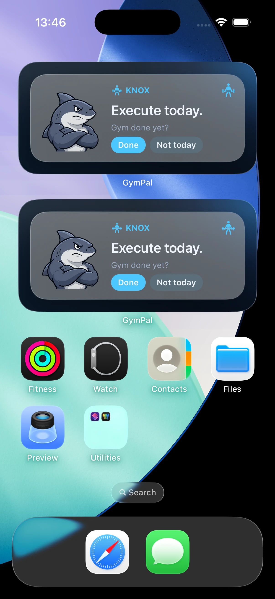

# GymPal

An iPhone app for keeping workout commitments, built collaboratively with Harel.

## Source code

**[Full GymPal source repository](https://github.com/harelmtr-sketch/gympal)** · **Private**

The shared development repository contains the complete Swift app, WidgetKit extension, tests, and backend integration. Access to that repository is required to view the code. This public repository provides a project overview and existing development captures.

## Product

Users choose a mascot companion, set a training schedule, and check in against their workout commitments. The app brings together a consistency dashboard, Home Screen and Lock Screen widgets, workout notes, and friend accountability.

The development build also includes an on-device equipment-photo check-in flow using Vision and Core ML. This recognizes equipment in a submitted photo; it does not establish that exercise occurred.

## My contribution

I work with Harel on the product and implementation. My contributions include onboarding, schedule selection, dashboard interactions, guide settings, and workout-note creation, editing, and history. I also contributed focused tests for note persistence and dashboard behavior.

The app uses SwiftUI, WidgetKit, and App Intents. Shared local state keeps the dashboard and widgets consistent, while queued changes sync with the backend. Mascot messages are selected from authored content using the user's workout state and history.

## Development captures

These captures show separate development iterations. The widget image uses an earlier mascot design.

| Welcome screen | Early interactive widget |
| --- | --- |
|  |  |

The product, implementation, and captures reflect our collaborative work.

[GitHub profile](https://github.com/ilaygibor)
